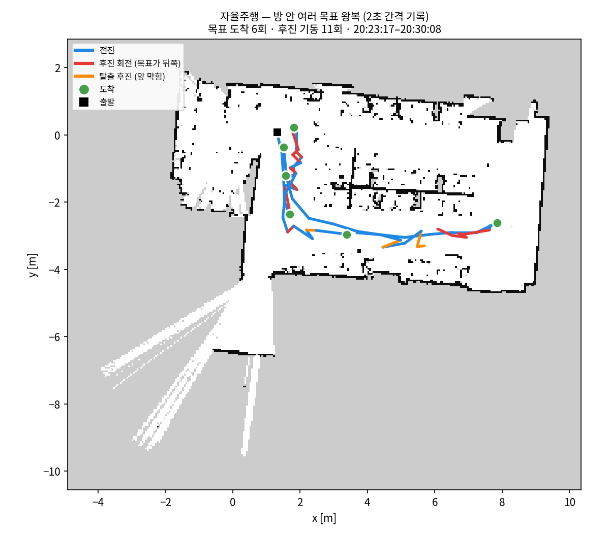
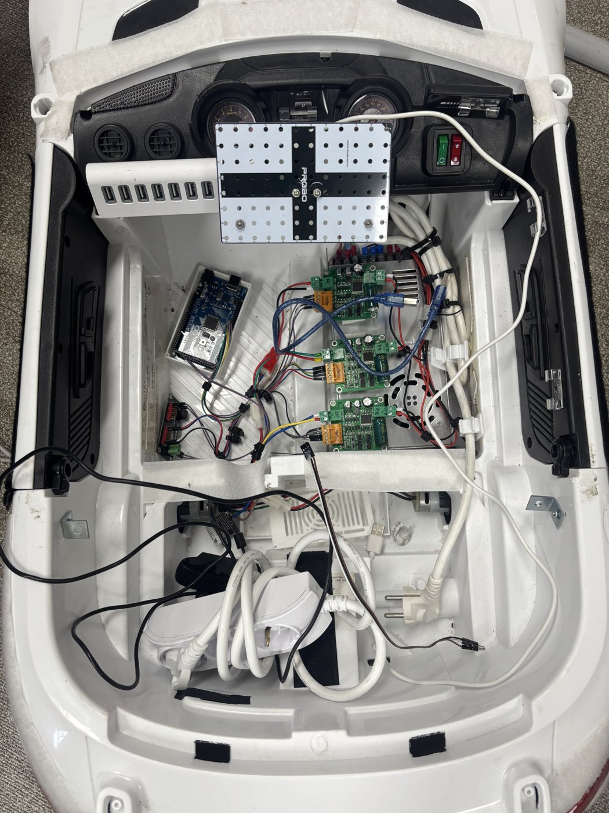
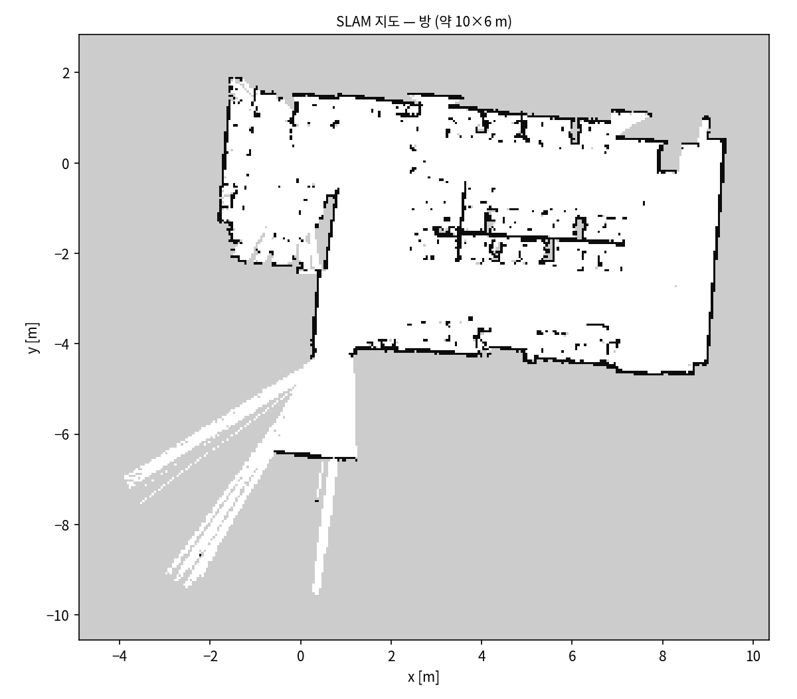
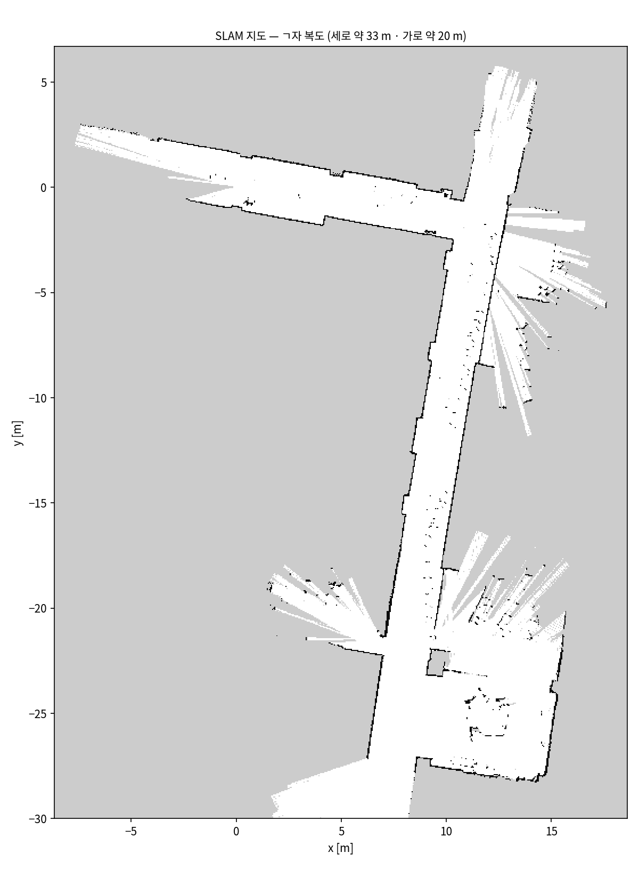

# MediScribe Rover — 엔코더 없이 달리는 회진 로봇의 자율주행

**1/5 스케일 애커만 차량을 라이다 하나와 자이로 하나로.** 지도 작성(SLAM), 위치 추정, 경로 계획, 장애물 대응까지
외부 SLAM 라이브러리 없이 순수 파이썬으로 직접 만들었다. 바퀴 엔코더도, 조향각 센서도 없다.

<p align="center">
  
  
</p>
<p align="center"><sub>왼쪽: 방 안에서 목표 6곳을 차례로 찍어 주행한 7분 기록 — 파랑 전진, 빨강 후진 회전, 주황 탈출 후진, 초록 도착.
오른쪽: 차량 내부 — 아두이노 Mega, 모터 드라이버 3개(좌·우 구동, 조향), USB 허브.</sub></p>

## 결과

| | |
|---|---|
| 지도 작성 | 방(약 10×6 m) 한 바퀴 4분 — 위치 상실 0회, 출발점으로 돌아와 궤적이 맞물림 |
| 자율주행 | 7분 동안 목표 6곳 도착, 후진 기동 11회 (애커만이라 제자리 회전 불가 → 후진하며 방향 전환) |
| 위치 추정 | 주행 중 차를 손으로 들어 옮겨도 스스로 위치를 다시 찾음 (상실 시 1초마다 헤딩 스윕 → 지역 탐색) |
| 처리 속도 | 스캔 10 Hz, 정합 + 제어 한 틱 45~80 ms (Jetson Orin NX CPU) |

<p align="center">
  
  
</p>

## 어떻게 동작하나

- **오도메트리 = 라이다 정합 + 자이로.** 매 스캔을 지금까지 만든 지도에 맞춰(scan-to-map, likelihood field, coarse→fine)
  이동량을 구하고, 회전은 D435i 자이로로 예측·보정한다. 점수가 낮은 스캔은 지도에 넣지 않는다.
- **지도 = 키프레임 포즈 그래프 + 점유격자.** 0.5 m / 25° 마다 키프레임, Gauss-Newton 최적화, log-odds 격자.
- **위치 추정 = 같은 정합기를 저장 지도에.** 놓치면 헤딩 360° 스윕 → 반경 2 m 격자 탐색으로 스스로 복구.
- **주행 = A* + 요레이트 서보 조향 + 후진 기동.** 조향각을 모르니 회전 속도로 닫고, 목표가 뒤쪽이면 먼저 후진한다.
  모든 거리 기준은 범퍼 기준(라이다가 앞범퍼 30 cm 뒤에 있음).

자세한 설명: **[docs/how-it-works.md](docs/how-it-works.md)**

## 하드웨어

| 부품 | 모델 | 연결 |
|---|---|---|
| 컴퓨터 | NVIDIA Jetson Orin NX 16GB (Super Dev Kit) | — |
| 라이다 | LDROBOT STL-27L (921600 bps, 10 Hz) | USB-시리얼(PL2303) → `/dev/ttyUSB0` |
| IMU | Intel RealSense D435i 내장 자이로 | USB, Linux iio |
| 모터 제어 | Arduino Mega 2560 + DC 모터 드라이버 3개 | USB 시리얼 → `/dev/ttyACM0` — [프로토콜](firmware/PROTOCOL.md) |
| 조종기 | Logitech F710 (XInput) | `/dev/input/js0` |
| 차체 | 1/5 스케일, 앞바퀴 DC 조향(각도 센서 없음) + 뒷바퀴 구동, 45 × 100 cm | |

## 빠른 시작

설치(커널 모듈, IMU 서비스): **[docs/setup.md](docs/setup.md)**

```bash
# 1) 조이스틱으로 몰면서 지도 만들기 — 뷰어 http://<젯슨>:8765
python3 scripts/mapping_joy.py                  # B 버튼 = 정지·저장·종료
python3 scripts/mapping_joy.py --no-motor       # 모터 없이(손으로 밀며) 시험

# 2) 저장한 지도로 자율주행 — 뷰어 http://<젯슨>:8766
python3 scripts/nav_drive.py --map out/joymap_<시각>.npz --pwm 120

# 3) 주행 기록을 지도 위 그림으로
python3 scripts/plot_run.py --map out/joymap_<시각>.npz --log out/joymap_<시각>_nav_<시각>.log -o run.png
```

**뷰어 조작** (자율주행): 왼쪽 클릭 = 목표 · 오른쪽 클릭+끌기 = 차 위치/방향 지정 · `s` 정지 · `g` 재개.
초록 점(현재 라이다)이 지도의 검은 벽과 겹치면 위치 추정이 맞은 것이다. 비상시에는 조이스틱 **B**.

## 폴더

```
medinav/        패키지
  hal/            STL-27L 파서, D435i 자이로(iio), 아두이노, 스캔 변환
  nav/            정합, 그래프 SLAM, 포즈 그래프, 점유격자, 재탐색, 코스트맵, A*
  core/ io/       SE(2) 연산, 마지막 위치 기억
  config.py       장착·센서 상수 (한 곳에서만 정의)
scripts/        mapping_joy · nav_drive · teleop_joy(끊김 진단 기록) · diag_gyro_axes · plot_run
system/         커널 모듈 빌드, IMU 부팅 서비스
firmware/       아두이노 명령 프로토콜
docs/           동작 원리, 설치, 그림
```
