# MediScribe — 회진을 따라다니며 듣고, 요약해서 환자에게 건네는 자율주행 의료 보조 로봇

**바퀴 엔코더도, 조향각 센서도 없는 1/5 스케일 애커만 차량을 라이다 하나와 자이로 하나로 병동 복도에서 스스로 달리게 했다.**
지도 작성(SLAM) · 위치 추정 · 전역/지역 경로 계획 · 장애물 대응을 외부 SLAM 라이브러리 없이 순수 Python + numpy 로 직접 구현했고,
그 위에 얼굴 인식 → 진료 대화 수음 → 온디바이스 LLM 요약 → 환자 전달로 이어지는 회진 동행 기능을 얹는다.

<p align="center">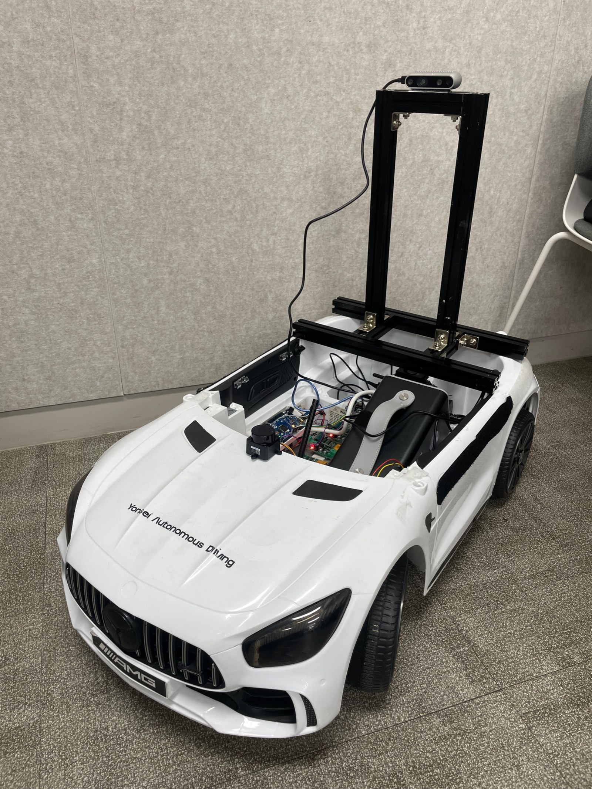</p>
<p align="center"><sub>1/5 스케일 애커만 차체 위에 알루미늄 프로파일 마스트를 세우고 D435i 를 전방으로, 후드 위에 STL‑27L 라이다를 올렸다.
Jetson Orin NX · Arduino Mega · 모터 드라이버 3개 · 파워뱅크가 차체 안에 들어간다.</sub></p>

연세대학교 · 의료 Physical AI 솔루션 경진대회(Y‑MAS 2026) · 남윤상 · 김진찬 · 김해인 · 지민선 · 멘토 하성욱 교수

[**🔧 하드웨어 `hw/`**](hw/) · [**💻 소프트웨어 `sw/`**](sw/) · [**📐 동작 원리**](sw/docs/how-it-works.md) · [**⚙️ 설치**](sw/docs/setup.md) · [**🔌 아두이노 프로토콜**](hw/firmware/PROTOCOL.md) · [**🧭 회진 파이프라인 기록**](pipeline/README.md)

---

## 지금까지의 결과

| | |
|---|---|
| 지도 작성 | 방(약 10 × 6 m) 한 바퀴 **4분** — 위치 상실 0회, 출발점으로 돌아와 궤적이 맞물림 |
| 자율주행 | **7분 동안 목표 6곳 도착**, 후진 기동 11회 (애커만이라 제자리 회전 불가 → 후진하며 방향 전환) |
| 위치 추정 | 주행 중 차를 손으로 들어 옮겨도 스스로 위치를 다시 찾음 (상실 시 1초마다 헤딩 스윕 → 지역 탐색) |
| 처리 속도 | 라이다 10 Hz · 정합 + 제어 한 틱 **45~80 ms** (Jetson Orin NX, CPU 만) |
| 장애물 | 지도에 없던 정적 장애물 앞 정지 → 후진 탈출 → 재계획 · 사람(동적 장애물) 감속·정지 · 좁은 곳 K턴 |

---

## 시스템 한눈에

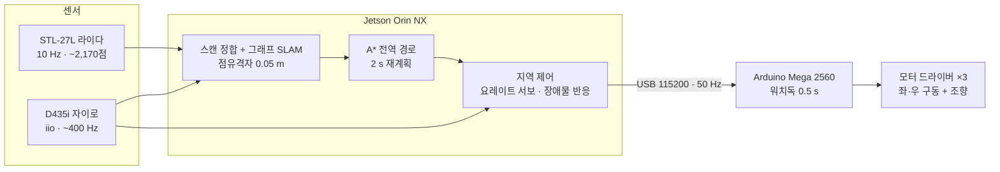

Jetson 은 액추에이터와 직접 연결되지 않는다. 모든 구동 명령은 Arduino 의 0.5 초 워치독을 거쳐야 모터에 닿는다.

### 회진 동행 시나리오 (Behavior Tree, ① → ⑤ 순차)

| | 단계 | 하는 일 | 상태 |
|---|---|---|---|
| ① | **따라간다** | 저장한 지도 위에서 위치를 잡고 목표(병실)까지 A* 경로로 자율주행 | ● 구현·실측 |
| ② | **알아본다** | 얼굴로 의사·환자 식별 (MTCNN → VGGFace2 임베딩 → 코사인 거리, 임계 0.35) | ● 구현·실측 |
| ③ | **듣는다** | ReSpeaker 마이크 어레이로 진료 대화 수음 → Riva ASR 한국어 전사 | ◐ 1차 검증 |
| ④ | **요약한다** | 온디바이스 LLM(qwen3 8B)이 환자용 SBAR 요약 | ◐ 1차 검증 |
| ⑤ | **건넨다** | 의사 1‑tap 검수 후 종이 A6 · 카카오톡으로 환자에게 | ○ 설계 단계 |

<p align="center">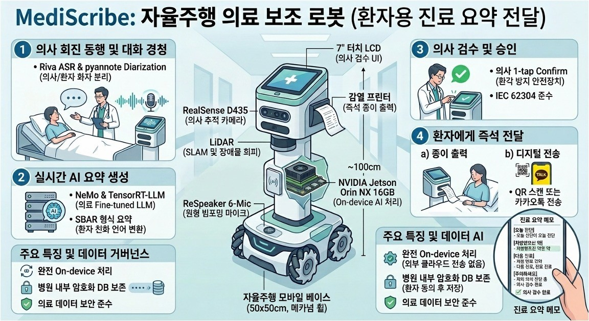</p>
<p align="center"><sub>목표 형상 개념도(팀 제작 일러스트, 설계 단계). 7″ 검수 LCD · 감열 프린터 · 카카오톡 전달까지 포함한 최종 형태이며, 아래 사진의 1/5 차량은 ①~④를 검증하는 1차 시제품이다.</sub></p>

이 저장소는 ①의 자율주행 스택이 중심이다. ②의 얼굴 인식 결과는 바로 아래, ③의 마이크 장착 상태는 [하드웨어](#하드웨어) 절에 있다.

### ② 알아본다 — 얼굴로 의사·환자 식별

<p align="center">
  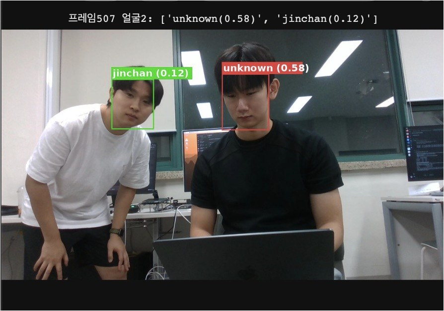
  &nbsp;&nbsp;
  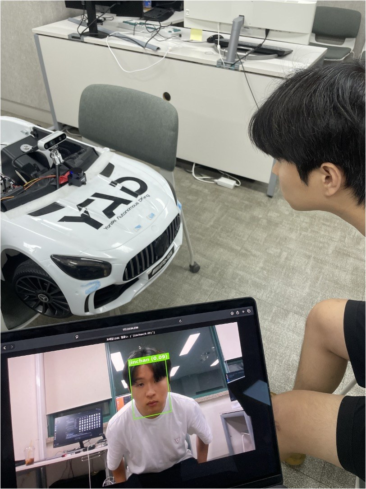
</p>
<p align="center"><sub>왼쪽: 등록된 의사(초록, 거리 0.12)와 미등록 인물(빨강, 0.58)을 한 프레임에서 구분. 오른쪽: 1/5 차량 앞에서 D435i 영상으로 현장 테스트.</sub></p>

- **MTCNN** 으로 얼굴을 찾고 **VGGFace2 임베딩(512‑d)** 을 뽑아 등록 벡터와의 **코사인 거리**로 판정한다. 임계값 0.35 — 등록 의사 0.12, 미등록 인물 0.58 로 여유 있게 갈린다.
- 등록은 사진 수십 장의 평균 벡터 한 줄이다. **재학습 없이** 의사·환자를 추가할 수 있다.
- 로봇은 이 결과로 "지금 앞에 있는 사람이 회진 중인 의사인가, 요약을 건넬 환자인가"를 정하고, 요약 전달 대상을 고른다. 얼굴 영상은 Jetson 밖으로 나가지 않는다.

---

## 하드웨어

<p align="center">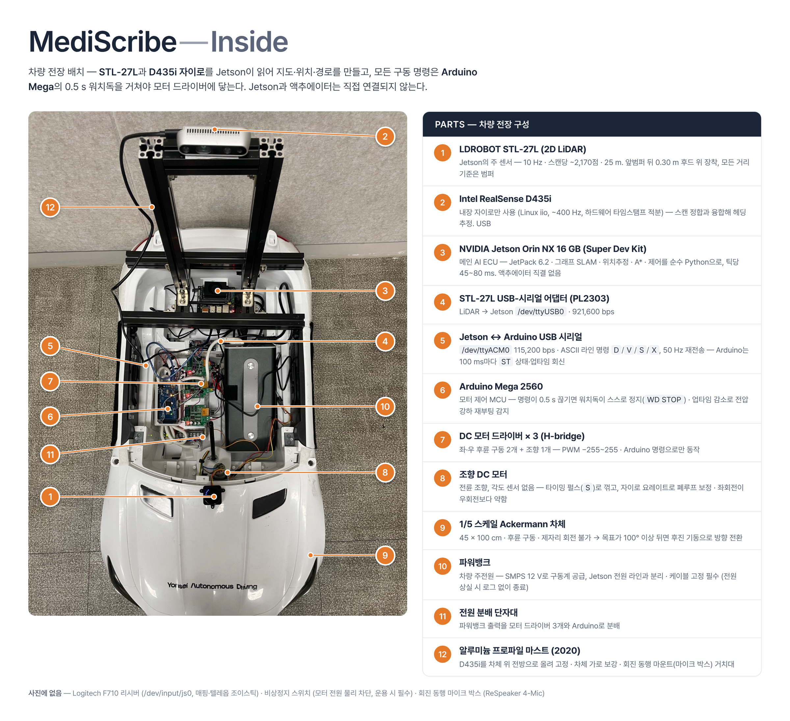</p>

| # | 부품 | 역할 · 연결 |
|---|---|---|
| 1 | **LDROBOT STL‑27L** (2D LiDAR) | 주 센서. 10 Hz · 스캔당 ~2,170점 · 25 m. 앞범퍼 뒤 0.30 m 후드 위 |
| 2 | **Intel RealSense D435i** | 내장 자이로만 사용 (Linux iio, 하드웨어 타임스탬프) — 헤딩 예측·요레이트 |
| 3 | **NVIDIA Jetson Orin NX 16 GB** | 메인 컴퓨터. JetPack 6.2 · 순수 Python SLAM·계획·제어 |
| 4 | STL‑27L USB‑시리얼 어댑터 (PL2303) | 라이다 → `/dev/ttyUSB0` · 921,600 bps |
| 5 | Jetson ↔ Arduino USB 시리얼 | `/dev/ttyACM0` · 115,200 bps · ASCII 라인 명령 |
| 6 | **Arduino Mega 2560** | 모터 제어 MCU. 명령이 0.5 s 끊기면 워치독이 스스로 정지 |
| 7 | DC 모터 드라이버 × 3 | 좌·우 후륜 구동 2개 + 조향 1개. PWM −255~255 |
| 8 | 조향 DC 모터 | 전륜 조향, 각도 센서 없음 → 타이밍 펄스 + 자이로 요레이트 폐루프 |
| 9 | 1/5 스케일 애커만 차체 | 45 × 100 cm · 후륜 구동 · 제자리 회전 불가 |
| 10 | 파워뱅크 | 차량 전원. Jetson 전원 라인과 분리 |
| 11 | 전원 분배 단자대 | 파워뱅크 출력 → 드라이버 3개 · Arduino |
| 12 | 알루미늄 프로파일 마스트 | D435i · ReSpeaker 거치, 차체 가로 보강 |

### 센서 마스트 — 2020 알루미늄 프로파일로 직접 제작

<p align="center">
  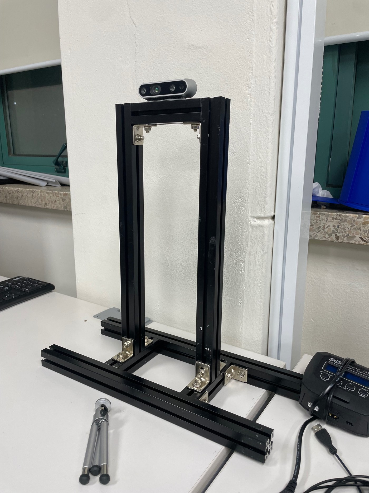
  &nbsp;&nbsp;
  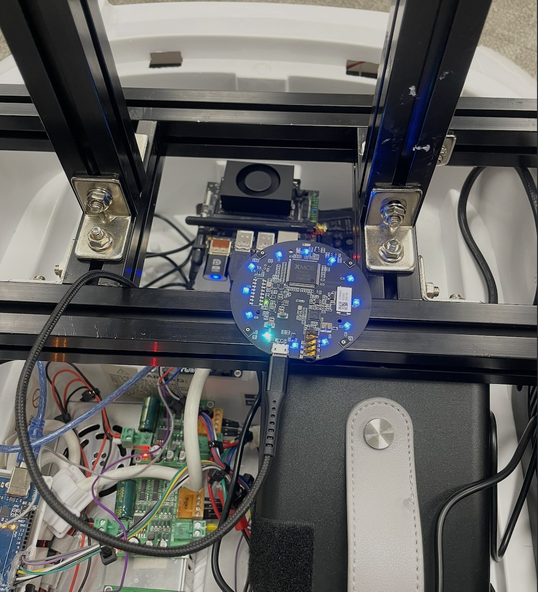
</p>
<p align="center"><sub>왼쪽: 2020 프로파일을 스프링 너트(슬롯 너트)와 L 브라켓으로 조립한 마스트. 아래 가로 프로파일 두 개가 차체 좌우를 잡고, 기둥 두 개가 D435i 를 차체 위로 올려 전방을 보게 한다.
오른쪽: Jetson 바로 앞, 가로 프로파일 위에 올린 ReSpeaker 마이크 어레이(XMOS) — USB 로 Jetson 에 연결.</sub></p>

- **왜 프로파일인가.** 장난감 차체(ABS)에 센서를 직접 나사로 박으면 주행 진동에 흔들리고, 센서 높이·각도를 바꿀 때마다 구멍이 늘어난다.
  2020 프로파일은 슬롯에 스프링 너트를 밀어 넣고 L 브라켓으로 어디든 조이면 되므로, **D435i 높이와 라이다 전방 거리(`config.py` 의 `BODY_BOX_M`)를 실측하면서 몇 번이고 옮겼다.**
  차체 좌우를 가로지르는 프로파일 두 개는 동시에 차체 보강재 역할을 한다 — 뚜껑을 뜯어낸 차체가 주행 중 벌어지지 않는다.
- **ReSpeaker 의 역할.** 회진 동행 시나리오 ③ **듣는다** 의 입력이다. 4‑마이크 원형 어레이로 **빔포밍·음원 방향(DoA)·노이즈 억제**를 보드 안(XMOS)에서 처리해
  깨끗한 단일 채널 음성을 Jetson 으로 보내고, Jetson 의 **NVIDIA Riva ASR 이 한국어로 전사**한다.
  환자 침상 옆에서 의사·환자 대화를 수음해야 하므로 마이크는 차체 위, 카메라와 같은 높이에 둔다. 전사 결과는 ④ **요약한다** 의 온디바이스 LLM(qwen3 8B, ollama) 로 넘어가 환자용 SBAR 요약이 된다.
  현재 상태: 모의 진료 3개 시나리오로 Riva 기본 모델의 의료 용어 치명 오류율 33 %(신장내과 53 %) 측정 — word boost · 후처리 용어 사전 · LoRA 보강이 다음 단계다.

더 자세한 부품 사양·배선·안전 사항은 [`hw/README.md`](hw/README.md), 아두이노 명령 규약은 [`hw/firmware/PROTOCOL.md`](hw/firmware/PROTOCOL.md).

---

## SLAM — 지도를 먼저 만드는 이유

<p align="center">
  
  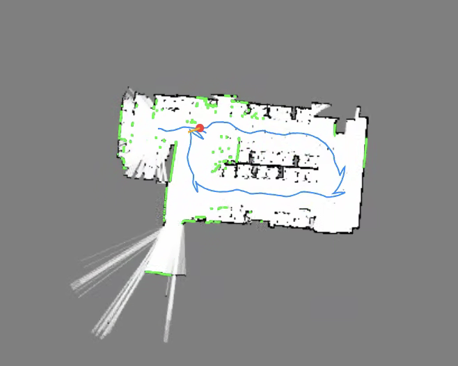
</p>
<p align="center"><sub>왼쪽: 완성한 지도 위에서 목표 6곳을 차례로 찍어 주행한 7분 기록 — 파랑 전진, 빨강 후진 회전(목표가 뒤쪽), 주황 탈출 후진(앞 막힘), 초록 도착.
오른쪽: 조이스틱으로 몰며 지도를 만드는 동안의 뷰어 — 검은 벽, 파란 궤적, 초록 현재 라이다 점.</sub></p>

### SLAM 이란

**SLAM(Simultaneous Localization and Mapping, 동시적 위치 추정 및 지도 작성)** 은 로봇이 처음 보는 공간에서
"내가 어디 있는지"와 "주변이 어떻게 생겼는지"를 **동시에** 알아내는 기술이다. 두 문제는 서로 맞물려 있다 —
지도가 있어야 내 위치를 알 수 있고, 내 위치를 알아야 센서가 본 것을 지도에 올바른 자리에 그릴 수 있다.
그래서 매 스캔마다 ① 직전 지도에 지금 스캔을 맞춰 이동량을 구하고, ② 그 위치에서 본 벽을 지도에 더하는 일을 반복한다.

### 왜 자율주행에 필요한가

병실 번호를 받아 그 방까지 가려면 로봇에게 **좌표계**가 필요하다. "복도 끝에서 왼쪽 두 번째 방"은 사람 말이고,
로봇에게는 "지도 좌표 (7.8, −2.6) m" 여야 한다. 지도가 없으면 ① 목표를 좌표로 표현할 수 없고, ② 벽과 문이 어디인지 몰라 경로를 짤 수 없고,
③ 자기 위치를 잃었을 때 되찾을 기준이 없다. 그래서 **먼저 조이스틱으로 한 바퀴 몰며 지도를 만들고(`mapping_joy.py`), 그 지도를 저장해 자율주행 때는 위치 추정에만 쓴다(`nav_drive.py`).**
이 차는 바퀴 엔코더가 없어 "얼마나 움직였는지"를 바퀴로 셀 수 없다 — 그 역할까지 라이다 SLAM 이 맡는다.

### 어떻게 구현했나 — 라이다 정합 + 자이로 + 그래프 SLAM

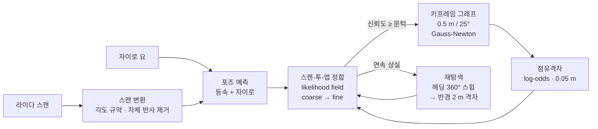

| 단계 | 구현 (`sw/medinav/`) | 핵심 수치 |
|---|---|---|
| 오도메트리 | `nav/scan_match.py` — 매 스캔을 지금까지의 지도에 맞춘다(scan‑to‑map). 점수판은 벽 셀을 흐리게 번진 likelihood field, 병진 후보 전체를 numpy 로 한 번에 평가 | 탐색창 ±0.18 m · ±11°, coarse → fine 2단계 |
| 회전 예측 | `hal/imu_iio.py` — D435i 자이로를 하드웨어 타임스탬프로 적분해 스캔 사이 요각을 넣는다 (USB 지터 무관) | ~400 Hz, 정지 시 바이어스 추적 |
| 신뢰도 게이트 | 정합 점수(점당 평균)가 낮은 스캔은 지도에 넣지 않는다 — 잘못 맞춘 스캔 하나가 지도를 영구히 망치기 때문 | `--min-conf 0.18` |
| 지도 | `nav/graph_slam.py` `nav/pose_graph.py` `nav/mapping.py` — 0.5 m / 25° 마다 키프레임 노드, SE(2) Gauss‑Newton 최적화, 광선이 지나간 셀은 빈 곳·끝점은 벽으로 log‑odds 누적 | 격자 0.05 m/셀, 벽 판정 p > 0.6 |
| 루프 닫힘 | 기본 **끔**. 엔코더 없이 비슷하게 생긴 곳을 "왔던 곳"으로 오인하는 해가 더 컸다 | `--loops` 로 켬 (채택 문턱 0.75, 최소 간격 20 키프레임) |
| 상실 복구 | `nav/relocalize.py` — 낮은 점수가 이어지면 1초마다 제자리 360° 헤딩 스윕, 3초 넘게 실패하면 반경 2 m · 0.25 m · 10° 격자 탐색 | **차를 들어 옮겨도 다시 찾는 이유** |

<p align="center">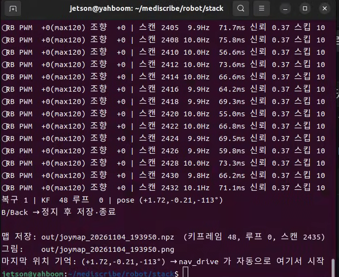</p>
<p align="center"><sub>매핑 종료 시 터미널 — 스캔 2,435장, 키프레임 48, 틱당 55~76 ms. 지도(.npz)와 마지막 위치를 저장하고, 다음 <code>nav_drive</code> 는 그 자리에서 시작한다.</sub></p>

---

## 경로 계획 — 전역과 지역

조향각을 모르는 애커만 차를 몰려면 "어디로 갈지"(전역)와 "지금 핸들·페달을 어떻게 할지"(지역)를 나눠서 푼다. 둘 다 `sw/scripts/nav_drive.py` 의 `Nav` 클래스가 한 스캔(100 ms)마다 돈다.

### 전역 — 코스트맵 + A*

| | 구현 | 수치 |
|---|---|---|
| 코스트맵 | `nav/costmap.py` — 저장 지도의 벽을 2층으로 부풀린다. **치명존**(벽에서 차폭/2 + 0.08 m 이내)은 통과 금지, **팽창존**(그 밖 0.25 m)은 거리에 따라 지수 감소하는 소프트 비용 | 치명 반지름 0.305 m, 팽창 0.25 m |
| 경로 | `nav/astar.py` — 8방향 A*(대각선 코너 컷 방지), 소프트 비용을 이동 비용에 더해 벽에서 넉넉히 떨어진 경로를 고른다. 결과는 직선 가시(LOS) 스무딩으로 지그재그 제거 → 0.1 m 간격으로 촘촘히 | 소프트 비용 가중 1.6 |
| 재계획 | 2초마다, 그리고 후진 기동이 끝날 때마다 현재 위치에서 다시 짠다 | `--replan 2.0` |

### 지역 — 주시점 추종 + 요레이트 서보

| | 방법 | 수치 |
|---|---|---|
| 주시점 | 경로에서 차와 가장 가까운 점부터 0.6 m 이상 떨어진 첫 점을 겨냥 | `--lookahead 0.6` |
| 조향 | 헤딩오차 × 1.5 → 목표 요레이트(상한 0.8 rad/s). **자이로로 잰 실제 요레이트**와 비교해 오차가 0.25 rad/s 를 넘으면 조향 모터에 80 ms 펄스. 각도를 지령할 수 없으니 회전 속도로 닫는다 | `--k-e 1.5 --w-max 0.8 --rate-thr 0.25 --pulse-ms 80` |
| 속도 | 기본 PWM 130. 앞범퍼 0.70 m 부터 선형 감속, 0.20 m 에서 정지. 헤딩오차 45° 이상 또는 목표 1 m 이내면 저속 | `--pwm 130 --pwm-min 100` |
| 도착 | 목표 0.35 m 이내 → 도착. 도착 방향이 지정되면 ±12° 안에 들 때까지 K턴 | `--goal-tol 0.35 --orient-deadband 12°` |

거리 기준은 전부 **범퍼 기준**이다. 라이다가 앞범퍼에서 0.30 m, 뒤범퍼에서 0.70 m 떨어져 있으므로 `--car-front 0.30 --car-rear 0.70 --car-halfw 0.225` 로 환산한다.

---

## 장애물 대응 — 세 가지 상황

전역 계획은 저장 지도만 본다. **지도에 없던 것**(새로 놓인 물건, 사람)은 매 스캔 라이다가 보는 정면·후방 창으로 **반응형**으로 처리한다.
정면 창은 로봇 프레임에서 `x > 0.05 m, |y| < 차폭/2 + 0.05 m` 안의 가장 가까운 점, 후방 창은 그 반대다.

### ① 정적 장애물 — 정지 → 후진 탈출 → 재계획

<p align="center">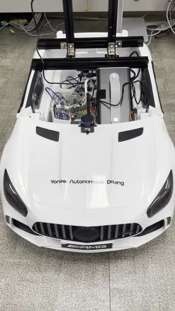</p>
<p align="center"><sub>지도에 없던 물건을 경로 위에 놓았다. 앞범퍼 0.70 m 부터 감속, 0.20 m 에서 멈춘 뒤 후진으로 빠져나와 다시 경로를 짠다. <a href="sw/media/static_obstacle.mp4">mp4</a></sub></p>

1. **감속·정지** — `clear`(정면 창 최소 거리)가 `slow_dist`(앞범퍼 + 0.70 m) 아래로 들어오면 PWM 을 선형으로 줄이고, `stop_dist`(앞범퍼 + 0.20 m) 아래면 `mode = blocked` 로 멈춘다.
2. **탈출 후진 (`rev_kind = "escape"`)** — 뒤범퍼 쪽에 0.40 m 이상 여유가 있으면 PWM −120 으로 후진하면서 조향을 **헤딩오차의 반대쪽**으로 준다. 후진 중엔 코끝이 반대로 돌기 때문에 이렇게 해야 차 앞이 목표 쪽으로 돌아간다.
   최소 2초 후진하되, 헤딩오차가 50° 안으로 들어오거나 / 뒤범퍼 0.20 m 가 되거나 / 6초가 지나면 끝낸다.
3. **재계획** — 후진이 끝난 위치에서 A* 를 다시 돌린다. 1초 쿨다운 뒤에도 또 막히면 반복하고, **연속 6회**를 넘기면 `stuck` 으로 정지해 사람을 기다린다.

관련 코드: `Nav.control()` 의 `clear / rear_clear` 계산과 `_reverse()`, 인자 `--escape-pwm --escape-s --escape-rear --escape-rear-stop --escape-cooldown --escape-max`.

### ② 동적 장애물 — 사람이 끼어들면

<p align="center">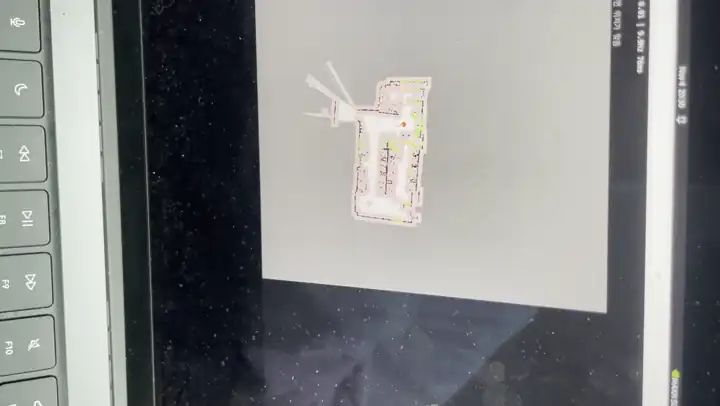</p>
<p align="center"><sub>주행 중 사람이 앞을 가로질러 들어온다. 정면 창에 잡히는 즉시 감속·정지하고, 사람이 비키면 그대로 다시 출발한다. <a href="sw/media/dynamic_obstacle.mp4">mp4</a></sub></p>

- 사람은 지도에 없으므로 전역 경로는 그대로 두고 **속도만** 잡는다. 정면 창 거리 하나로 감속 곡선을 타므로 걸어오는 사람에게 0.70 m 에서 부드럽게 줄기 시작해 0.20 m 에서 선다.
- 라이다 10 Hz 에 정합·제어 45~80 ms 이므로 사람을 보고 정지 명령까지 최악 약 180 ms(스캔 주기 100 ms + 처리 80 ms), 여기에 Arduino 50 Hz 명령 주기가 더해진다. 그래서 실내 주행 PWM 을 130 으로 묶어 둔다.
- 사람이 바로 비키지 않고 `stop_dist` 안에 계속 있으면 ①과 같은 탈출 후진으로 넘어간다. 사람이 뒤에 있으면 후방 창(`rear_clear`)이 후진을 막는다 — 양쪽이 다 막히면 그냥 멈춘다.
- 조향 명령은 자이로 요레이트로 닫히기 때문에, 정지했다가 다시 출발할 때 `speed_est` 가 0.03 m/s 를 넘기 전까지는 헤딩오차 ±20° 로 직접 조향 펄스를 준다(출발 직후엔 요레이트가 아직 없다).

지금은 사람을 **피해서 돌아가는** 경로 계획은 하지 않는다(멈추고 기다리는 쪽이 병동에서 안전하다고 봤다). `Costmap.augmented()` 가 라이다 점을 임시 장애물로 합쳐 재계획하도록 준비돼 있어, 동적 장애물 우회는 다음 단계다.

### ③ 제자리 회전 — 애커만 차의 K턴

<p align="center">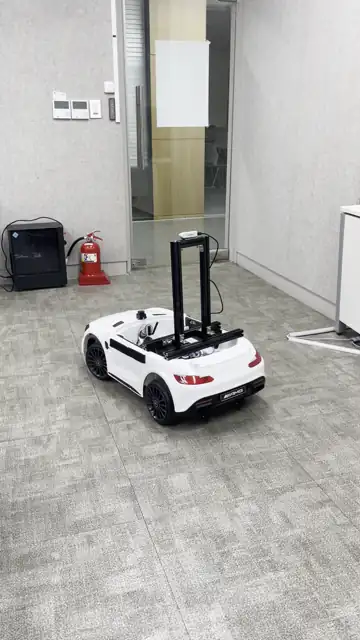</p>
<p align="center"><sub>목표를 차 뒤쪽에 찍었다. 차는 먼저 후진하며 반대로 꺾어 코를 목표 쪽으로 돌린 뒤 전진한다 — 좁은 방에서 전진 원호만으로는 돌 수 없다. <a href="sw/media/turn_in_place.mp4">mp4</a></sub></p>

애커만 차는 차동 로봇처럼 제자리에서 돌 수 없다. 그래서 두 가지 기동으로 "제자리 회전"을 흉내 낸다.

| 기동 | 언제 | 어떻게 |
|---|---|---|
| **후진 회전** (`rev_kind = "turn"`) | 주시점 헤딩오차가 **100° 를 넘고** 뒤범퍼 0.40 m 여유가 있을 때 — 즉 목표가 뒤쪽 | 후진하면서 조향을 헤딩오차 반대쪽으로. 헤딩오차 50° 안으로 들어오면 전진 추종으로 복귀 (최대 6초). 좁은 방에서 전진 원호만 반복하며 헤딩오차가 줄지 않던 문제를 이것으로 잡았다 |
| **K턴 정렬** (`mode = "align"`) | 목표 지점엔 도착했는데 **도착 방향**이 ±12° 밖일 때 (병실 앞에서 문을 향해 서야 할 때) | 1.5초씩 전진/후진을 교대하며 조향 부호를 바꿔 헤딩만 돌린다. 전진 위상에 앞이 막히면 그 위상을 건너뛰고, 후진 위상에 뒤가 막히면 멈춘다 |

둘 다 조향 모터에는 각도 센서가 없으므로 "얼마나 꺾였는지"를 모른다. 대신 **자이로가 잰 요레이트**로 실제로 돌고 있는지를 보고 펄스를 더 줄지 정한다. 왼쪽 조향이 오른쪽보다 약한 하드웨어 특성 때문에 왼쪽 K턴은 위상이 한 번 더 들어가는 편이다.

관련 인자: `--rev-turn-deg 100 --rev-exit-deg 50 --rev-turn-rear --rev-max-s 6 --align-pwm 110 --align-s 1.5 --orient-deadband`.

---

## 빠른 시작

설치(커널 모듈, IMU 서비스): [`sw/docs/setup.md`](sw/docs/setup.md). 모든 명령은 `sw/` 에서 실행한다.

```bash
cd sw
pip3 install --user -r requirements.txt

# 1) 조이스틱으로 몰면서 지도 만들기 — 뷰어 http://<젯슨>:8765
python3 scripts/mapping_joy.py                  # B 버튼 = 정지·저장·종료
python3 scripts/mapping_joy.py --no-motor       # 모터 없이(손으로 밀며) 시험

# 2) 저장한 지도로 자율주행 — 뷰어 http://<젯슨>:8766
python3 scripts/nav_drive.py --map out/joymap_<시각>.npz --pwm 120

# 3) 주행 기록을 지도 위 그림으로
python3 scripts/plot_run.py --map out/joymap_<시각>.npz --log out/joymap_<시각>_nav_<시각>.log -o run.png
```

**뷰어 조작** (자율주행): 왼쪽 클릭 = 목표 · 오른쪽 클릭+끌기 = 차 위치/방향 지정 · `s` 정지 · `g` 재개.
초록 점(현재 라이다)이 지도의 검은 벽과 겹치면 위치 추정이 맞은 것이다. 비상시에는 조이스틱 **B**, 그리고 **물리 비상정지 스위치**.

---

## 저장소 구조

```
README.md                  ← 이 문서
hw/                        하드웨어                                  → hw/README.md
  images/                  차량 · 부품 배치 · 마스트 · ReSpeaker 사진
  firmware/PROTOCOL.md     Arduino Mega 명령 프로토콜 (펌웨어 v3)
sw/                        소프트웨어                                → sw/README.md
  medinav/                 패키지
    hal/                   STL‑27L 파서, D435i 자이로(iio), Arduino, 스캔 변환
    nav/                   스캔 정합, 그래프 SLAM, 포즈 그래프, 점유격자, 재탐색, 코스트맵, A*
    core/ io/              SE(2) 연산, 마지막 위치 기억
    config.py              장착·센서 상수 (한 곳에서만 정의)
  scripts/                 mapping_joy · nav_drive · teleop_joy · diag_gyro_axes · plot_run
  system/                  커널 모듈 빌드, IMU 부팅 서비스
  docs/                    동작 원리 · 설치 · 결과 그림
  media/                   주행 영상 (webp 애니메이션 + mp4)
  requirements.txt
pipeline/README.md         회진 전체 흐름 · 메모리·기동 시간 실측 · 시행착오 기록
```

## 알려진 한계

- 특징 없는 긴 복도에서는 진행 방향 위치가 흐려질 수 있다(벽만 평행하게 보이면 앞뒤 이동을 구분하기 어렵다).
- 정합은 스캔 사이 ±11° 안에서만 따라간다 — 10 Hz 기준 초당 110° 넘게 돌면 놓친다. 자이로 예측이 이를 완화한다.
- 왼쪽 조향이 오른쪽보다 약하다(기구 또는 드라이버).
- 움직이는 장애물을 **피해 가는** 경로 계획은 아직 없다. 멈추고 기다린다.
- 아두이노 워치독은 "명령 끊김"만 잡는다. 젯슨이 잘못된 명령을 계속 보내는 경우는 물리 비상정지만이 막는다.

## 팀

**MediScribe** · 연세대학교 · 남윤상 · 김진찬 · 김해인 · 지민선 (건설환경공학과 · 간호학과) · 멘토 하성욱 교수
의료 Physical AI 솔루션 경진대회 (Y‑MAS 2026)
