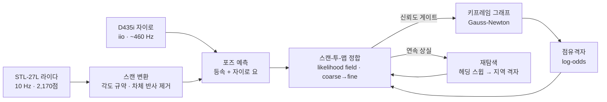

# 동작 원리

엔코더도, 조향각 센서도 없는 1/5 스케일 애커만 차량을 라이다 하나와 자이로 하나로 지도 작성·위치 추정·자율주행까지 한다.
외부 SLAM 라이브러리(ROS, slam_toolbox, Cartographer 등)를 쓰지 않고 순수 파이썬과 numpy 로 직접 구현했다.

## 1. 바퀴 없이 오도메트리 만들기 — 라이다 정합 + 자이로

바퀴 엔코더가 없으니 "얼마나 움직였는지"를 라이다로 잰다.

1. **예측**: 직전 두 스캔 사이 이동의 절반만큼 더 갔다고 가정한다(등속). 회전량은 그 시간 동안 **자이로가 잰 요각**으로 바꿔 넣는다.
   자이로는 하드웨어 타임스탬프로 적분하므로 USB 도착 지터를 타지 않는다.
2. **정합**: 예측 포즈 주변(±0.18 m, ±11°)을 거칠게 → 정밀하게 두 단계로 훑어, 스캔 점들이 **지도의 벽 근처에 가장 잘 얹히는 포즈**를 고른다.
   점수판은 벽 셀을 흐리게 번진 likelihood field 다(가까울수록 점수 높음). 병진 후보 전체를 numpy 로 한 번에 평가한다.
3. **신뢰도 게이트**: 정합 점수(점당 평균)가 낮은 스캔은 **지도에 넣지 않는다**. 잘못 맞춘 스캔 하나가 지도를 영구히 망치기 때문이다.
4. **상실 복구**: 낮은 점수가 이어지면 1초마다 복구를 시도한다. 먼저 제자리 360° 헤딩 스윕(손으로 돌린 경우가 대부분),
   3초 넘게 못 찾으면 반경 2 m · 0.25 m · 10° 격자 탐색. **차를 들어서 옮겨도 다시 위치를 찾는 이유**가 이것이다.

## 2. 지도 — 키프레임 포즈 그래프 + 점유격자

- 0.5 m 또는 25° 움직일 때마다 **키프레임**(포즈 + 스캔)을 그래프 노드로 추가하고, 연속 키프레임 사이 상대변환을 엣지로 잇는다.
- 그래프는 SE(2) Gauss-Newton 최소제곱으로 최적화한다 (Grisetti et al., *A Tutorial on Graph-Based SLAM*).
- 점유격자(0.05 m/셀)는 광선이 지나간 셀은 빈 곳, 끝점은 벽으로 log-odds 를 누적한다.
- **루프 닫힘은 기본으로 끈다.** 엔코더가 없으면 비슷하게 생긴 다른 곳을 "왔던 곳"으로 잘못 받아들이는 일이 더 해로웠다.
  켜려면 `--loops` (채택 문턱 0.75, 최소 간격 20 키프레임 — 엄격하게).

## 3. 위치 추정 — 저장한 지도 위에서

주행 때도 같은 정합기를 쓴다. 지도는 고정이고, 매 스캔을 저장 지도에 맞춘다.
- 시작 위치: 마지막으로 끝난 자리(같은 지도일 때) → 헤딩 360° 스윕 + 반경 탐색으로 보정. 뷰어에서 **오른쪽 클릭+끌기**로 직접 지정할 수도 있다.
- 조향 제어에 쓰는 회전 속도(요레이트)는 자이로 값을 직접 쓴다.

## 4. 주행 — 조향각 센서 없는 애커만 차를 모는 법

| 단계 | 방법 |
|---|---|
| 코스트맵 | 벽에서 `차폭/2 + 0.08 m` 이내는 통과 금지, 그 밖 0.25 m 까지는 거리에 따라 줄어드는 비용 |
| 전역 경로 | 8방향 A* + 직선 가시(LOS) 스무딩, 2초마다 재계획 |
| 조향 | 0.6 m 앞 주시점까지의 헤딩오차 → 목표 요레이트. 자이로로 잰 실제 요레이트와 비교해 조향 모터에 **좌/우 펄스**를 준다. 각도를 지령할 수 없으니 회전 속도로 닫는다 |
| 속도 | 앞범퍼 거리 0.70 m 부터 감속, 0.20 m 에서 정지. 크게 꺾을 때와 목표 1 m 안에서는 저속 |
| 후진 기동 | 애커만은 제자리 회전이 안 된다. **목표가 100° 넘게 뒤쪽**이고 뒤범퍼에 0.40 m 여유가 있으면 먼저 후진하며 반대로 꺾어 차 앞을 목표 쪽으로 돌린다. 앞이 막히면 후진 탈출. 후진은 헤딩오차 50° 이내 / 뒤범퍼 0.20 m / 6초 중 먼저 오는 것에서 끝난다 |
| 장애물 | 정면·후방 판정 폭은 차폭 + 5 cm. 사람 같은 움직이는 장애물은 **반응형**으로 처리한다(감속·정지 → 필요하면 후진 탈출 → 재계획). 경로 계획에 넣어 미리 돌아가지는 않는다 |

거리 기준은 전부 **범퍼 기준**이다. 라이다가 앞범퍼에서 0.30 m 뒤에 있으므로 `--car-front 0.30 --car-rear 0.70 --car-halfw 0.225` 로 환산한다.

## 5. 알려진 한계

- 특징 없는 긴 복도에서는 진행 방향 위치가 흐려질 수 있다(벽만 평행하게 보이면 앞뒤 이동을 구분하기 어렵다).
- 정합은 스캔 사이 ±11° 안에서만 따라간다. 10 Hz 기준 초당 110° 넘게 돌면 놓친다 → 자이로 예측이 이를 완화한다.
- 왼쪽 조향이 오른쪽보다 약하다(하드웨어).
- 움직이는 장애물을 피해 가는 경로 계획은 없다(위 표 참고).
