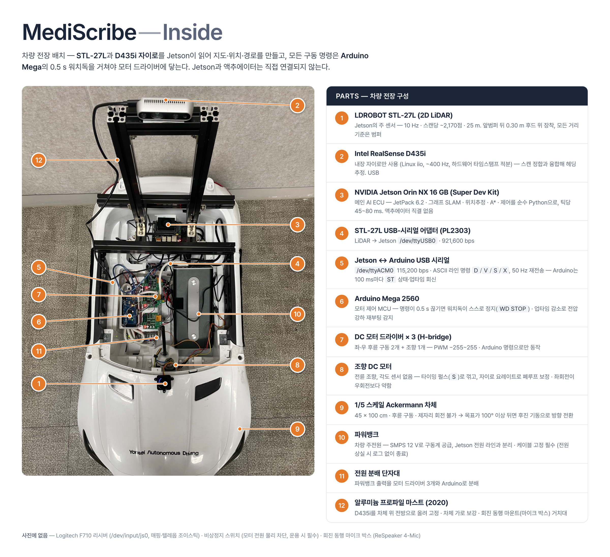
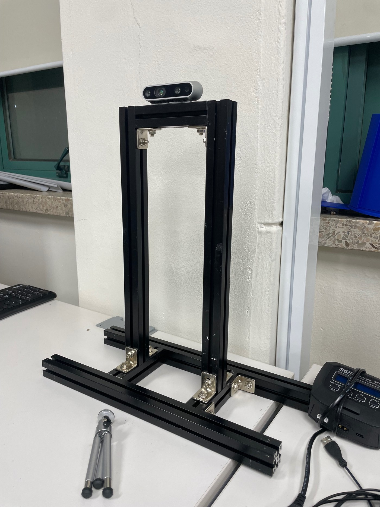
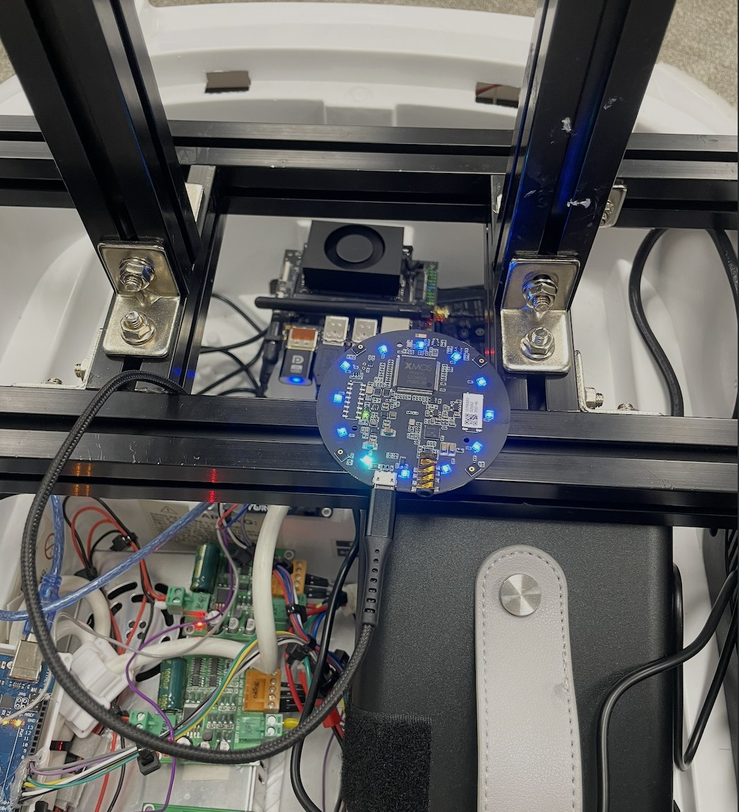

# 하드웨어

1/5 스케일 애커만 차체(장난감 전동차 베이스)에 라이다·자이로·Jetson·Arduino 를 올린 구성이다.
바퀴 엔코더와 조향각 센서가 없다는 점이 이 차의 가장 큰 특징이고, 소프트웨어 설계 전체가 여기서 출발한다.

## 부품 목록

| # | 부품 | 모델 · 사양 | 연결 | 비고 |
|---|---|---|---|---|
| 1 | 2D 라이다 | **LDROBOT STL‑27L** — 10 Hz, 스캔당 ~2,170점, 25 m, 921,600 bps | USB‑시리얼(PL2303) → `/dev/ttyUSB0` | 후드 위, 앞범퍼 뒤 0.30 m. 소프트웨어의 모든 거리 기준은 범퍼 |
| 2 | 자이로 (IMU) | **Intel RealSense D435i** 내장 자이로 | USB → Linux iio (hid‑sensor) | RGB·Depth 는 지금 안 쓴다. 부팅 때 펌웨어 재시작 필요 → `sw/system/` 서비스 |
| 3 | 메인 컴퓨터 | **NVIDIA Jetson Orin NX 16 GB** Super Dev Kit · JetPack 6.2 | — | SLAM·계획·제어 전부 CPU, Python 3.10 |
| 4 | 라이다 어댑터 | LDROBOT USB‑시리얼 보드 (PL2303) | 라이다 ↔ Jetson USB | 젯슨 기본 커널에 PL2303 드라이버가 없다 → 직접 빌드 |
| 5 | 명령 링크 | Jetson ↔ Arduino USB 시리얼 | `/dev/ttyACM0` · 115,200 bps | ASCII 라인 명령 — [`firmware/PROTOCOL.md`](firmware/PROTOCOL.md) |
| 6 | 모터 제어 MCU | **Arduino Mega 2560** · 펌웨어 v3 | USB | 명령 0.5 s 끊기면 워치독 정지. 100 ms 마다 상태 회신 |
| 7 | 모터 드라이버 | DC 모터 드라이버(H‑bridge) × 3 | Arduino PWM/DIR | 좌 후륜 · 우 후륜 · 조향 |
| 8 | 조향 | 전륜 DC 모터 (차체 원래 것) · 각도 센서 없음 | 드라이버 #3 | 타이밍 펄스로만 꺾는다. 왼쪽이 오른쪽보다 약함 |
| 9 | 차체 | 1/5 스케일 애커만 · 45 × 100 cm · 후륜 구동 | — | 제자리 회전 불가 |
| 10 | 전원 | 파워뱅크 | 단자대 → 드라이버·Arduino | Jetson 전원 라인과 분리 |
| 11 | 전원 분배 | 나사식 단자대 | — | |
| 12 | 마스트 | 2020 알루미늄 프로파일 + 스프링 너트 + L 브라켓 | — | D435i · ReSpeaker 거치, 차체 가로 보강 |
| — | 마이크 | **ReSpeaker 마이크 어레이 (XMOS, 4‑mic)** | USB → Jetson | 회진 대화 수음 (③ 듣는다) |
| — | 조종기 | Logitech F710 (XInput, 뒷면 스위치 **X**) | `/dev/input/js0` | 매핑·텔레옵·데드맨 |
| — | 비상정지 | 모터 전원 물리 차단 스위치 | — | 운용 시 필수 — 워치독은 "명령 끊김"만 잡는다 |

## 센서 마스트

- **재료**: 2020 알루미늄 프로파일(가로 2개 + 기둥 2개 + 상단 1개), 스프링 너트(슬롯 너트), L 브라켓, M5 볼트.
- **구조**: 가로 프로파일 두 개가 차체 좌우 벽을 가로지르며 고정된다 — 뚜껑을 뜯어낸 차체가 주행 중 벌어지지 않게 잡는 보강재이기도 하다.
  기둥 두 개가 그 위에 서고, 상단 프로파일에 D435i 를 올린다.
- **왜 이렇게 했나**: 장난감 차체(ABS)에 센서를 직접 나사로 박으면 진동에 흔들리고, 높이·각도를 바꿀 때마다 구멍이 늘어난다.
  프로파일은 슬롯에 스프링 너트를 밀어 넣고 아무 위치에나 브라켓을 조일 수 있어, 센서 위치를 실측하며 여러 번 옮겼다.
  센서를 옮기면 `sw/medinav/config.py` 의 `BODY_BOX_M`(차체 반사 제거 상자)과 `--car-front / --car-rear` 를 다시 잰다.

## ReSpeaker 마이크 어레이

- **위치**: Jetson 바로 앞, 가로 프로파일 위. 환자 침상 옆에서 의사·환자 대화를 수음해야 하므로 차체 위, 카메라와 같은 높이에 둔다. USB 한 가닥으로 Jetson 에 연결.
- **맡는 일**: 회진 동행 시나리오 ③ **듣는다**의 입력. 4개 마이크의 원형 어레이로 **빔포밍·음원 방향(DoA)·노이즈 억제·에코 제거**를 보드 안 XMOS 칩이 처리해 깨끗한 단일 채널 음성을 내보낸다.
  Jetson 은 그 음성을 **NVIDIA Riva ASR** 로 한국어 전사하고, 전사문은 ④ **요약한다**의 온디바이스 LLM(qwen3 8B, ollama)이 환자용 SBAR 요약으로 만든다.
  로봇 밖으로 음성이 나가지 않는다 — 추론은 전부 Jetson 안에서 한다.
- **현재 상태**: 모의 진료 3개 시나리오로 Riva 기본 모델의 의료 용어 치명 오류율 33 %(신장내과 53 %) 측정. word boost · 후처리 용어 사전 · LoRA 추가학습으로 보강하는 것이 다음 단계.
  화자 분리(pyannote)는 설계 단계.

## 전원

- 파워뱅크 → 단자대 → 모터 드라이버 3개 + Arduino. Jetson 은 별도 라인.
- 젯슨 전원선이 주행 중 당겨지지 않게 고정한다. 전원이 끊기면 그 자리에서 꺼진다(기록 없이).
- Arduino 상태 회신의 가동 시간이 **줄어들면** 전압 강하로 재부팅된 것이다 — 모터 기동 전류가 원인일 때가 많다.

## 안전

- **물리 비상정지**(모터 전원 차단)를 손 닿는 곳에 둔다. 워치독은 젯슨이 죽거나 USB 가 빠진 경우만 잡는다.
- F710 이 버튼 눌림 상태로 굳은 적이 있다. 주행 전 `sw/scripts/teleop_joy.py --dry` 에서 RB 가 놓임인지 확인한다.
- 첫 시험은 바퀴를 띄우고 한다 (`teleop_joy.py --max 120`).

## 사진

| 파일 | 내용 |
|---|---|
| `images/vehicle_main.jpg` | 차량 전체 (메인 사진) |
| `images/vehicle_inside_bom.png` | 차량 내부 부품 배치 (번호 = 위 표) |
| `images/mast_build.jpg` | 프로파일 마스트 조립 |
| `images/respeaker_mount.jpg` | ReSpeaker · Jetson 장착부 |
| `images/face_field_test.jpg` | 얼굴 인식 현장 테스트 (1/5 차량 앞) |
| `images/concept_illustration.jpg` | 목표 형상 개념도 (팀 제작 일러스트, 설계) |
