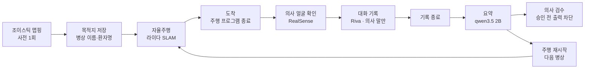

# MediScribe 회진 파이프라인 — 설계 · 측정 · 시행착오 전체 기록

회진 동행 로봇이 **병상까지 스스로 가서, 의사의 말만 듣고, 온디바이스 LLM 으로 환자용 메모를 만드는** 전 과정을 정리한 문서다.
모든 숫자는 Jetson Orin NX 16GB 실기에서 직접 잰 값이고, 잰 날짜를 함께 적었다.

> 이 저장소에는 현재 **주행 스택**(`sw/medinav/`, `sw/scripts/`)이 공개되어 있다. 음성·요약·회진 진행 코드는 젯슨 작업 폴더에 있으며,
> 이 문서는 그 구조와 측정 결과를 설명한다.

---

## 0. 한눈에

| 항목 | 값 | 측정일 |
|---|---|---|
| 요약 안전 항목 보존율 | **100%** (77/77, 회진 대화 20건) | 10/02 |
| 환자 발화가 요약에 섞인 건수 | 게이트 없음 16/23 → **게이트 켬 0/23** | 10/02 |
| 실연(2인 낭독)에서 환자 발화 차단 | **13/13**, 위험 오정보 3/3 차단 | 10/02 |
| 자율주행 | 7분간 목표 6곳 도착, 후진 기동 11회 | 11/04 |
| 회진 한 사이클(모터 없이) | 대기 → 주행 → 도착 → 기록 → 요약 → 재대기 **43초**(말소리 없는 시험) | 11/08 |
| 대화 중 가용 메모리 | 요약 모델을 대화 후로 미뤄 **약 1.2 GB → 약 4.3 GB** | 11/08 |

---

## 1. 하드웨어와 연결 (11/08 재조립 기준)

| 장치 | 모델 | 연결 | 확인 결과 |
|---|---|---|---|
| 컴퓨터 | Jetson Orin NX 16GB, Super Dev Kit, JetPack 6.2 (L4T R36.4.3) | — | 전원 모드 MAXN_SUPER |
| 깊이 카메라 + IMU | Intel RealSense D435i (펌웨어 5.15.1.55) | **USB 3.x 직결 (5000M)** | 컬러+깊이 640×480 **29.7 fps**, 자이로 정상 |
| 마이크 | ReSpeaker Mic Array v2.0 (6채널, XMOS) | USB 2.0 허브 | 6채널 녹음, 음원 방향(DOA) 읽기 정상 |
| 조종기 | Logitech F710 (XInput) | USB 2.0 허브 | 버튼 11·축 8 인식 |
| 라이다 | LDROBOT STL-27L | USB-시리얼(PL2303) | 10.3 Hz, 스캔당 2,164점 |
| 모터 제어 | Arduino Mega 2560 (펌웨어 v3) | USB 시리얼 | 응답 정상, 워치독 0.5 s |
| 화면 | HDMI/DP 더미 플러그 | — | 1920×1080 고정 (원격 데스크톱용) |

- USB 2.0 허브는 내부에 허브가 하나 더 있는 7포트 제품이다. 조이스틱·마이크는 대역폭이 작아 허브로 충분하다.
- **카메라는 반드시 USB 3 포트 직결.** USB 2 로 잡히면 해상도·프레임이 크게 제한된다.
- 재조립 뒤 라이다 패킷 오류가 0% → 0.67% 로 늘었다. 깨진 패킷은 버리므로 주행엔 지장 없으나, 라이다 선이 모터 전원선 옆을 지나면 잡음이 는다.

---

## 2. 회진 한 사이클 — 단계별 시간

회진 진행 프로그램(화면 `:8770`)이 아래 순서를 자동으로 잇는다. 목적지는 화면에서 "현재 위치를 목적지로 저장"(병상 이름 + 환자명)으로 만든다.

| 단계 | 하는 일 | 걸린 시간 (11/08 실측) |
|---|---|---|
| 대기 | 주행 프로그램 실행, 지도 위 위치 추정 | 시작 후 준비까지 **약 3 s** |
| 주행 | 저장한 목적지로 자율주행 | 거리에 따라 |
| 도착 → 주행 종료 | 주행 프로그램을 끝내 메모리·라이다·모터 해제 (마지막 위치 저장) | 1 s 미만 |
| 기록 준비 | 얼굴 인식 모델 + 카메라 기동 | **약 8~10 s** |
| 의사 확인 | 등록된 의사 얼굴이 보일 때까지 대기 (최대 120 s) | 사람에 따라 |
| 기록 | Riva 실시간 인식, 의사 방향 발화만 채택 | 대화 길이 (최대 600 s, 보통 [기록 종료] 버튼) |
| 요약 | 기록 프로그램 종료 후 요약 모델을 올려 문장별 추출 | **의사 문장당 약 3~4 s** (9문장 39 s, 3문장 15 s) |
| 복귀 | 요약 모델 내림 → 주행 프로그램 재시작 | **약 3 s** |

**설계 결정 — 대화 중에는 요약 모델을 올리지 않는다(11/08).**
처음엔 대화하면서 문장마다 바로 요약했다(끝나는 즉시 메모 완성). 그러면 대화 중 Riva + 얼굴 인식 + 요약 모델이 한꺼번에 올라가
가용 메모리가 **1.2 GB** 까지 떨어졌다. 요약을 대화 뒤로 미루니 대화 중 가용 메모리가 **약 4.3 GB** 가 됐다.
대가는 기록 종료 후 요약 대기(3분 대화 ≈ 1분). 요약 방식은 실시간과 똑같이 문장을 하나씩 넣으므로 품질은 그대로다.

**설계 결정 — Riva 는 계속 켜 둔다.** Riva 를 병상마다 끄고 켜면 도착할 때마다 1분 넘게 기다려야 하고(아래 기동 시간),
기동 실패 위험도 그만큼 는다. 주행 프로그램은 가벼워서 Riva 와 함께 있어도 충분하다.

---

## 3. 메모리 예산 (CPU·GPU 가 16 GB 를 함께 씀)

젯슨은 CPU 와 GPU 가 같은 메모리를 쓴다. GPU 에 올린 모델도 전부 이 16 GB 에서 빠진다.

### 구성 요소별

| 구성 요소 | 사용량 | 비고 |
|---|---|---|
| 데스크톱 + 원격 데스크톱 + 편집기 | 약 4.5~5 GB | 11/03. 편집기(VS Code)의 화면 그리기 프로세스가 CPU 코어 하나를 거의 다 쓰기도 함 → 시연 땐 닫는다 |
| **Riva 음성인식** (Conformer ko-KR 스트리밍) | **약 4.4~4.6 GB** | 11/08 컨테이너 실측. 상시 상주 |
| **요약 LLM** qwen3.5:2b Q4_K_M, num_ctx 2048 | **약 3.2 GB** | 올리면 가용 5.2 → 1.7 GB (11/08) |
| 얼굴 인식 (MTCNN + FaceNet) + 카메라 | 약 0.5~0.7 GB | 11/08 기록 준비 전후 가용 메모리 차이. 신경망 자체의 GPU 사용은 ~110 MB |
| 주행 (SLAM·측위·제어, numpy) | 작음 | torch 를 쓰지 않는다 |

### 사이클 동안 가용 메모리 (11/08, 회진 진행 프로그램 실측)

| 시점 | 대화 중 요약(이전 방식) | 대화 후 요약(현재 방식) |
|---|---|---|
| 대기 (Riva + 주행) | 3.5 GB | 5.0 GB |
| 대화 중 | **1.2~1.6 GB** | **4.3 GB** |
| 요약 중 (Riva + LLM) | — | 최저 1.65 GB |
| 끝나고 복귀 | 4.1 GB | 4.5 GB |

### 과거 사고에서 얻은 규칙
- **Riva 와 Whisper large-v3 를 동시에 올리지 않는다.** 9월에 스왑이 5.8 GB 까지 차며 젯슨이 멈췄다.
- 무거운 실험은 cgroup 상한을 건 래퍼(memguard)로만 돌리고, 메모리 감시(memwatch)가 위험할 때 무거운 작업을 먼저 끈다.
- 요약 모델을 Q8 + ctx 4096(4.5 GB)에서 **Q4_K_M + ctx 2048(약 3.2 GB)** 로 바꿨다. 채점 품질은 같았다.

---

## 4. 기동 시간

| 대상 | 시간 | 비고 |
|---|---|---|
| Riva 처음 설치 (모델 변환 포함) | 10분 이상 | 한 번만 |
| **Riva 재기동** (컨테이너 시작 → 모델 READY) | **약 62 s** | 11/08 로그 실측 |
| 요약 모델 냉시작 | **7.6 s** | 11/03. 이미 올라가 있으면 0.6 s |
| 주행 프로그램 (지도 로드 → 위치 확정) | 약 2~4 s | 스캔 20회 + 신뢰도 기준 통과까지 |
| 얼굴 인식 + 카메라 | 약 8~10 s | |
| IMU 부팅 서비스 (카메라 펌웨어 재시작 포함) | 약 17 s | 부팅 때 자동 (11/04 기록) |
| 젯슨 부팅 → 원격 데스크톱 | 측정 안 함 | 원격 데스크톱 서비스는 부팅 때 자동 시작 |

---

## 5. 젯슨 성능 (11/03 실측)

| 항목 | 기본(동적 클럭) | 클럭 최대 고정 | 참고 |
|---|---|---|---|
| GPU FP16 행렬곱 | 8.5 TFLOPS | 8.6 | 이론치의 약 88% |
| 메모리 대역폭 | 54 GB/s | 67 GB/s | 이론 102 GB/s |
| 요약 LLM 생성 속도 | 23.1 토큰/s | 24.3 | |
| CPU sha256 1코어 / 8코어 | 1.2 / 4.6 GB/s | — | |
| NVMe 쓰기 / 읽기 | 0.92 / 1.4 GB/s | — | |

**결론: 고장이나 저전력 모드가 아니다.** 느리게 느껴진 주원인은 메모리(데스크톱 앱이 이미 5 GB 가까이 씀)였다.
클럭 고정의 이득은 LLM 기준 5% 정도라 선택 사항이다.

---

## 6. 음성 파이프라인

### 6.1 음성인식: Riva 를 고른 이유
같은 실제 마이크 녹음("공복혈당이 180이고 당화혈색소가 8.2퍼센트입니다. 메트포르민을…")으로 비교했다.

| 엔진 | 결과 |
|---|---|
| **Riva ko-KR (Conformer)** | 숫자는 정확, 약 이름은 깨짐("메트포르민" → "포르 이을") |
| Whisper large-v3 | "다음 영상에서 만나요." (전체 날조) |
| Whisper large-v3-turbo | 같은 날조, 숫자 반복 |

- Riva 는 **2.19.0 으로 고정**. 2.24 부터 Jetson Orin 지원이 끊겼다. 한국어 Citrinet 은 지연이 커서 Conformer 를 쓴다.
- **스트리밍 확정 결과(is_final)만 요약에 넣는다.** 중간 결과는 "길리가 → 길이가 시켜 → …"처럼 바뀌므로 거기서 사실을 뽑으면 날조가 된다.
- **단어 부스팅**: 의학 용어를 Riva 에 힌트로 준다(강도 20). 근거리에서 "메트포르민" 인식이 1/3 → 3/3.
- **약품명 교정기**: 부스팅으로도 남는 깨짐("매트 포로 인")을 약품 사전(290개 성분명)과 **자모 유사도**로 되돌린다.
  조사를 떼고, 사실상 같은 소리인 모음(ㅐ/ㅔ 등)을 접어서 비교한다. 임계값을 낮추면 "아스팔트"가 "아스피린"이 되는 오탐이 생겨
  임계(0.78)는 유지했다. 일반 분류어(혈압약·진통제 등)는 "혈압이"를 "혈압약"으로 바꾸는 오탐이 있어 교정 대상에서 뺐다.
- 의미가 뒤집히는 오인식("덜합니다" → "더합니다")은 코드로 못 고친다 → **의사 검수가 존재하는 이유.**

### 6.2 요약: 2B 모델로 안전하게
- 일괄 요약은 3초 목표가 물리적으로 불가능했다(토큰 생성이 병목). → **문장 단위 증분 추출** 구조.
- 모델이 매번 메모 전체를 다시 쓰면 앞의 정보를 잊는다 → 모델은 **새 사실만** 내고, 코드가 누적·중복 제거·섹션 분류를 한다.
- 규칙 기반 추출(용량·일정·경고·복용법)을 먼저 돌리고, 모델은 보조로 쓴다. 숫자나 약 이름이 원문에 없는 출력은 **날조로 보고 버린다.**
- 중복 제거 3단계: 같은 섹션 / 다른 섹션 / 축약판("아스피린 저녁에 시작" vs "아스피린 하루 백 밀리그램 저녁에 시작").
- 채점: 회진 대화 20건(진료과 다양, 그중 12건은 시연 대본이 아님)의 정답지 대비

| 시점 | 전체 보존 | 안전 보존 |
|---|---|---|
| 9/7 (14건) | 96.0% | 98.1% |
| 10/2 규칙 보강 후 (20건) | **99.1%** | **100%** |

### 6.3 의사 말만 듣기 — 화자분리 모델 없이
화자분리 모델(pyannote)은 가중치 1 GB 에 실시간이 어렵고, 이 장비엔 올릴 메모리가 없었다. 대신 **방향**으로 가른다.
1. RealSense 컬러 영상에서 등록된 의사 얼굴을 찾는다(MTCNN 검출 + FaceNet 512차원 비교, 프레임당 66~194 ms).
2. 얼굴 위치와 카메라 보정값으로 **의사의 방위각**을 계산한다.
3. 마이크 칩이 계산한 **음원 방향(DOA)** 을 같은 좌표계로 바꿔(1회 보정, 잔차 약 14.5°) 차이가 ±45° 안이면 의사 발화로 채택한다.

| 입력 | 전체 보존 | 안전 보존 | 환자 발화 섞임 |
|---|---|---|---|
| 의사+환자 전체 (게이트 없음) | 98.3% | 98.7% | **16/23 (위험 8)** |
| 의사 발화만 (게이트) | 98.3% | 98.7% | **0/23** |

게이트 없이 섞인 위험 오정보 예: 약국에서 산 **5배 과용량**, 다른 병원의 잘못된 용량, 잘못 기억한 투약 횟수, 틀린 응급 기준 체온.

**한계(실측으로 확인)**: 두 사람이 마이크에서 같은 방향에 있으면 구분할 수 없다. 나란히 앉았을 때 차이 6~7°로 환자 발화가 전부 통과했고,
직각으로 벌리자 94~162° 차이로 전부 걸렀다. → 시연 배치: 의사는 마이크 정면 30~50 cm, 환자는 마이크 옆쪽 1 m.
두 사람을 모두 화면에서 추적해 "더 가까운 쪽"으로 가르는 방식도 시도했으나 미등록자 추적이 불안정해 기본으로 꺼 두었다.

⚠️ **하드웨어를 다시 조립하면 마이크–카메라 보정을 다시 해야 한다.**

### 6.4 검수와 출력
요약은 의사가 화면(`:8080`)에서 고치고 **승인해야만** QR·A6 인쇄로 나간다. 승인 전에는 출력 경로가 전부 403 으로 막힌다.

---

## 7. 주행 파이프라인 (요약)

자세한 원리는 [sw/docs/how-it-works.md](../sw/docs/how-it-works.md), 하드웨어는 [hw/README.md](../hw/README.md).

- **바퀴 엔코더 없이** 오도메트리를 만든다: 매 스캔을 지도에 정합(scan-to-map) + D435i 자이로로 회전 보정.
- 키프레임 포즈 그래프(Gauss-Newton) + 점유격자. 외부 SLAM 라이브러리 없이 직접 구현.
- 위치를 잃으면 1초마다 헤딩 360° 스윕 → 반경 2 m 격자 탐색으로 스스로 복구. 들어서 옮겨도 다시 찾는다.
- 주행: A* 전역 경로 + 0.6 m 앞 주시점 + **자이로 요레이트 피드백 조향 펄스**(조향각 센서 없음) + 범퍼 기준 감속·정지.
- **로컬 플래너는 따로 두지 않았다.** 움직이는 장애물은 반응형(감속·정지 → 후진 탈출 → 재계획)으로 처리한다.
  현재 주행 품질로 충분하다고 판단해 유지(11/08).
- 애커만은 제자리 회전이 안 된다 → 목표가 100° 넘게 뒤쪽이면 먼저 후진하며 반대로 꺾는다.

**slam_toolbox + RViz 로 갈아타지 않은 이유(11/04)**: 엔코더가 없어 라이다 오도메트리 노드를 따로 붙여야 하고,
아두이노 제어를 ROS 2 로 다시 연결해야 하며, 주행 코드가 쓰는 지도 형식도 바꿔야 한다. 메모리도 1 GB 안팎 더 든다.
이미 목표에 도착하는 스택을 버리는 대신 직접 만든 SLAM 을 다듬었다. 시각화는 브라우저 뷰어(지도·궤적·현재 라이다 점)로 해결했다.

---

## 8. 시행착오와 해결 (시간순)

| 날짜 | 증상 | 원인 | 해결 |
|---|---|---|---|
| 10/02 | 디스크 100% (233 GB) | 카메라 udev 규칙이 띄운 제어 도구가 무한 루프로 **로그 파일 하나에 119 GB** 기록 | 멈춘 프로세스 종료 → 로그 비우기 → 규칙 비활성, 로그 회전·저널 상한 |
| 10/02 | 얼굴 인식·OpenCV 계열이 전부 import 실패 | 사용자 영역에 설치된 numpy 2.x 가 numpy 1.x 로 빌드된 패키지를 깨뜨림 | numpy 1.26.4 고정 |
| 10/02 | 마이크 방향 읽기 Pipe error, 녹음 실패 | 세션 비정상 종료 반복으로 XMOS 제어 인터페이스가 꼬임 | USB 리셋 스크립트(뽑았다 꽂는 효과) |
| 10/02 | 게이트가 같은 코드로 성공·실패가 갈림 | 두 사람의 각도 차이(자리) | 읽기 전 **배치 사전점검**(각도 부족하면 시작 안 함) |
| 10/02 | 녹음 프로그램 종료 시 `terminate called…` | 카메라 C++ 스레드가 살아 있는 채 종료 | 11/08: 저장 후 즉시 종료하도록 수정 |
| 11/03 | 원격 데스크톱이 계속 끊김 | ① 4K 화면을 CPU 로 AV1 압축 ② 서로 다른 망(통신사망·학교망)을 뚫은 연결이 24초마다 강제 종료 | 1080p(더미 플러그), 같은 핫스팟, VP8 코덱 |
| 11/04 | 맵핑·주행 중 자이로 보정이 조용히 꺼져 있었음 | 커널이 축값을 **32비트 칸에 16비트**로 주는데 32비트 통째로 읽음 → 정지 중에도 수백만 °/s | 커널의 형식 정보를 읽어 해석 |
| 11/04 | 자이로 축이 틀림 | 위 버그 때문에 검증된 적이 없었음 | 진단 도구로 실측: **y 축, 부호 −1** |
| 11/04 | 카메라를 부팅 후 꽂으면 자이로 데이터 없음 | 준비 서비스가 부팅 때 한 번만 돎 | 꽂은 뒤 서비스 재시작 |
| 11/04 | 좁은 곳에서 계속 앞으로만 가며 회전 | 후진이 "앞 막힘" 조건 안에 있어 몇 cm 만에 전진 복귀, 목표가 뒤여도 후진을 고려 안 함 | 후진 기동 재작성 |
| 11/04 | 후진하면 뒤에 부딪힐 수 있었음 | 거리 기준이 라이다가 차 가운데 있다고 가정(실제는 앞범퍼 30 cm 뒤) | 모든 기준을 **범퍼 기준**으로 재계산 |
| 11/04 | 조이스틱 RB 가 손을 안 댔는데 눌린 상태 | 무선 수신기 상태 꼬임 | 수신기 재연결. 데드맨이 무력화되므로 **물리 비상정지 필수** |
| 11/04 | 주행 중 젯슨이 갑자기 꺼짐 | 정상 종료 기록 없음 → 전원 끊김 | 전원선 고정·배터리 확인 |
| 11/08 | 회진 흐름이 요약 단계를 건너뜀 | 기록 프로그램이 저장 직후 비정상 종료 코드(−6) | 저장 후 즉시 종료 + 원문이 저장됐으면 계속 진행 |
| 11/08 | 진행 상태 신호를 놓칠 수 있음 | 실시간 인식 중간 글자 뒤에 같은 줄로 붙어 나옴 | 줄 중간에서도 신호를 찾도록 수정 |
| 11/08 | 주행 프로그램을 "준비됨"으로 너무 일찍 판단 | 첫 위치를 잡기 전 기본값을 믿음 | 스캔 20회 + 신뢰도 기준 통과 후에만 |

---

## 9. 시연 전 체크리스트

- [ ] 카메라는 USB 3 직결, 마이크·조이스틱은 허브 — 장치 인식 확인
- [ ] 카메라를 부팅 후 꽂았다면 IMU 서비스 재시작
- [ ] **마이크–카메라 보정** (재조립했다면 필수)
- [ ] Riva 기동 확인 (재기동 약 1분)
- [ ] 편집기·브라우저 등 무거운 데스크톱 앱 닫기
- [ ] 조이스틱 버튼이 눌린 채 굳어 있지 않은지 확인, 물리 비상정지 손에
- [ ] 젯슨 전원선 고정
- [ ] 의사는 마이크 정면 30~50 cm, 환자는 마이크 옆쪽 1 m
- [ ] 목적지(병상) 저장 → 한 바퀴 시험

## 10. 남은 일

- 실제 의사·환자 2인으로 회진 한 사이클 전체 시험 (도착 → 얼굴 확인 → 기록 → 요약 → 다음 병상)
- 요약 대기 단축: 문장 2~3개 묶어 추출(품질 재채점 필요)
- 움직이는 장애물을 피해 가는 경로(라이다 장애물을 코스트맵에 반영) — 필요해지면
- 왼쪽 조향 약함(하드웨어), 라이다 잡음 원인 확인
