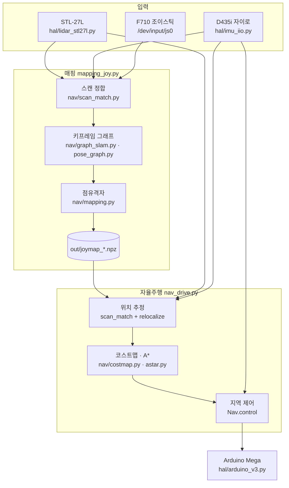

# 소프트웨어

엔코더도 조향각 센서도 없는 애커만 차를 라이다 하나와 자이로 하나로 지도 작성·위치 추정·자율주행까지 하는 스택이다.
ROS·slam_toolbox·Cartographer 같은 외부 SLAM 은 쓰지 않았고, 순수 Python + numpy 로 Jetson Orin NX CPU 에서 돈다.

모든 명령은 이 폴더(`sw/`)에서 실행한다.

## 구조

```
medinav/                  패키지
  config.py               장착·센서 상수 — 라이다 각도 규약, 차체 반사 상자, 자이로 축, 격자 해상도 (한 곳에서만 정의)
  hal/
    lidar_stl27l.py       STL‑27L 시리얼 파서 (CRC 검사, 10 Hz 스캔 조립)
    lidar.py              스캔 → 로봇 프레임 광선 변환, 차체 반사 제거
    imu_iio.py            D435i 자이로 읽기 (Linux iio, 하드웨어 타임스탬프)
    imu.py                자이로 요각 적분기 — 정합 초기값·검증, 정지 시 바이어스 추적
    arduino_v3.py         Arduino Mega 펌웨어 v3 명령 (D/V/S/X), 50 Hz 재전송
  nav/
    scan_match.py         스캔‑투‑맵 정합 (likelihood field, coarse → fine)
    graph_slam.py         키프레임 그래프 SLAM 본체
    pose_graph.py         SE(2) 포즈 그래프 · Gauss‑Newton
    mapping.py            점유격자 (log‑odds), 저장/불러오기
    relocalize.py         상실 복구 — 헤딩 스윕, 지역 격자 탐색
    costmap.py            치명존 + 팽창존 2층 코스트맵 (ROS costmap 방식)
    astar.py              8방향 A* + 직선 가시 스무딩
  core/se2.py             SE(2) 합성·역변환
  io/lastpose.py          마지막 위치 기억 (다음 주행이 그 자리에서 시작)
scripts/
  mapping_joy.py          조이스틱으로 몰며 지도 작성 — 뷰어 :8765
  nav_drive.py            저장 지도로 자율주행 — 전역 A* · 지역 제어 · 장애물 반응 · 후진 기동 · 뷰어 :8766
  teleop_joy.py           수동 주행 + 끊김 진단 CSV
  diag_gyro_axes.py       자이로 요 축·부호 실측
  plot_run.py             주행 로그를 지도 위 그림으로
system/
  build_kmods.sh          PL2303 · xpad · hid‑sensor 커널 모듈 빌드 (젯슨 기본 커널에 빠져 있음)
  d435i-imu-setup.sh      부팅 시 D435i 펌웨어 재시작 (자이로 데이터가 나오게)
  d435i-imu.service / install_imu_service.sh
docs/
  how-it-works.md         동작 원리 (정합 · 그래프 SLAM · 위치 추정 · 주행)
  setup.md                설치
  images/                 결과 그림
media/                    주행 영상 (webp 애니메이션 + mp4)
requirements.txt
```

## 데이터 흐름



## 실행

```bash
pip3 install --user -r requirements.txt          # numpy 1.26 고정 — 2.x 는 JetPack 의 cv2 와 충돌
sudo usermod -aG dialout $USER                   # 시리얼 권한 (다시 로그인)

# 장착 확인 (한 번)
python3 -m medinav.hal.lidar_stl27l --seconds 5  # 10 Hz, ~2,170점, CRC 오류 0% 면 정상
python3 -u scripts/diag_gyro_axes.py             # 반시계 90° 돌려 요 축·부호 확인 → config.py
python3 scripts/teleop_joy.py --dry              # 조이스틱만
python3 scripts/teleop_joy.py --max 120          # 바퀴 띄우고 방향 확인

# 지도 작성 → 자율주행 → 기록 그림
python3 scripts/mapping_joy.py                   # B = 정지·저장·종료, 뷰어 http://<젯슨>:8765
python3 scripts/nav_drive.py --map out/joymap_<시각>.npz --pwm 120     # 뷰어 http://<젯슨>:8766
python3 scripts/plot_run.py --map out/joymap_<시각>.npz --log out/joymap_<시각>_nav_<시각>.log -o run.png
```

커널 모듈과 IMU 부팅 서비스 설치는 [`docs/setup.md`](docs/setup.md).

## 주요 인자 (`nav_drive.py`)

거리는 라이다 기준으로 재므로, 범퍼까지의 거리를 더해 기준을 만든다. 기본값은 실측 차체(앞 0.30 · 뒤 0.70 · 반폭 0.225 m)에서 자동 계산된다.

| 묶음 | 인자 | 기본 | 뜻 |
|---|---|---|---|
| 차체 | `--car-front --car-rear --car-halfw` | 0.30 / 0.70 / 0.225 | 라이다 → 앞범퍼 / 뒤범퍼 / 차폭 절반 [m] |
| 속도 | `--pwm --pwm-min` | 130 / 100 | 주행 PWM 과 감속 하한 |
| 정면 | `--slow-dist --stop-dist` | 앞범퍼 +0.70 / +0.20 | 감속 시작 / 정지 |
| 판정 폭 | `--halfw` | 차폭/2 +0.05 | 정면·후방 창 반폭 |
| 코스트맵 | `--radius --inflation` | 차폭/2 +0.08 / 0.25 | 치명존 반지름 / 팽창존 |
| 전역 | `--replan --lookahead --goal-tol` | 2.0 s / 0.6 m / 0.35 m | 재계획 주기 / 주시점 / 도착 반경 |
| 조향 | `--k-e --w-max --rate-thr --steer-pwm --pulse-ms` | 1.5 / 0.8 rad/s / 0.25 / 255 / 80 | 헤딩오차→요레이트 이득 / 상한 / 펄스 문턱 / 펄스 크기 / 길이 |
| 탈출 후진 | `--escape-pwm --escape-s --escape-rear --escape-rear-stop --escape-cooldown --escape-max` | 120 / 2 s / 뒤범퍼 +0.40 / +0.20 / 1 s / 6회 | 앞 막힘 → 후진 |
| 후진 회전 | `--rev-turn-deg --rev-exit-deg --rev-turn-rear --rev-max-s` | 100° / 50° / 뒤범퍼 +0.40 / 6 s | 목표가 뒤쪽 → 후진하며 회전 |
| K턴 정렬 | `--align-pwm --align-s --orient-deadband` | 110 / 1.5 s / 12° | 도착 방향 맞추기 |
| 측위 | `--min-conf --init --init-radius` | 0.18 / 마지막 위치 / 1.5 m | 정합 신뢰 문턱 / 초기 포즈 / 초기 탐색 반경 |

## 주행 모드 (`Nav.mode`)

`idle` 대기 · `drive` 경로 추종 · `blocked` 앞 막힘 정지 · `escape` 탈출 후진 · `reverse` 후진 회전 · `align` K턴 정렬 · `arrived` 도착 · `noplan` 경로 없음 · `lost` 위치 상실 · `stuck` 탈출 6회 초과 · `manual` 조이스틱 수동(RB).

터미널 한 줄 상태: `[mode] 신뢰 c lost n | PWM p 조향 s | 정면 d m 헤딩오차 e° 요레이트 w°/s | pose (x,y,θ) Hz ms` — 2초마다 `out/*_nav_*.log` 에도 남는다.

## 동작 원리

정합 · 그래프 SLAM · 위치 추정 · 주행의 수식과 수치는 [`docs/how-it-works.md`](docs/how-it-works.md). 장애물 대응 세 가지(정적 · 동적 · 제자리 회전)는 [루트 README](../README.md#장애물-대응--세-가지-상황).
